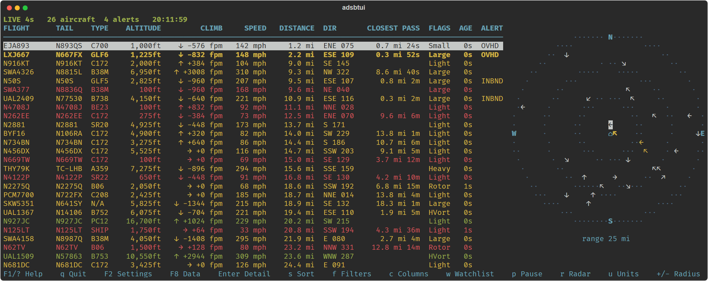
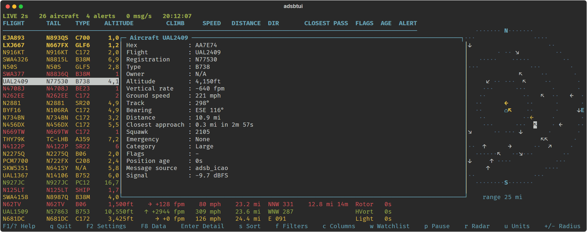

# ADSB-TUI

A terminal UI for watching aircraft near you, fed by your own `readsb` or `dump1090-fa` receiver.
Python 3.11+, no third-party dependencies.



- Radar scope and a sortable table with distance, bearing and closest approach from your location
- Registration, type and owner filled in from a registry that downloads and refreshes itself
- Alerts for overhead, inbound and emergency traffic: bell, desktop, webhook or shell command
- Filters, search, a watchlist and sighting history
- Script-friendly modes (`--once`, `--headless`, `--batch`) that need no terminal

## Install

```bash
git clone https://github.com/WPTK/ADSB-TUI.git
cd ADSB-TUI
pip install -e .            # Windows: pip install -e ".[windows]"
```

**Raspberry Pi OS** blocks plain `pip install`. Use pipx:

```bash
sudo apt install pipx && pipx ensurepath   # then open a new shell
pipx install --editable .
```

To update, `git pull` and restart adsbtui. A pipx install made without `--editable` won't pick
up the pull; fix it once with `pipx install --force --editable .`.

## Quick start

```bash
adsbtui
```

The first run starts a setup wizard that finds your receiver and home location and writes
`~/.config/adsbtui/config.toml`. To skip it:

```bash
adsbtui --url 192.168.3.80 --lat 37.7749 --lon -122.4194
```

`--url` takes a receiver address (the usual `aircraft.json` paths are probed), an exact URL, or
a local file such as `/run/readsb/aircraft.json`.

## Keys

| Key | Action |
|---|---|
| `F1` / `?` | Help |
| `F2` / `,` | Settings (every option, saved to `config.toml`) |
| `F8` / `D` | Aircraft registry: status and manual update |
| `Enter` | Details for the selected aircraft |
| `s` / `f` / `c` / `w` | Sort / filter and search / columns / watchlist |
| `r` / `u` / `p` | Toggle radar / cycle units / pause |
| `+` / `-` | Grow / shrink the radius |
| `q` | Quit |



## Without the UI

```bash
adsbtui --once --format json    # one snapshot (also table, csv)
adsbtui --headless              # run as a service: alerts and history, no screen
adsbtui --batch                 # stream SEEN/NEW/LOST/ALERT lines
adsbtui --check                 # validate config and fetch once
```

## Configuration

Settings (`F2`) covers every option. Flags override `ADSBTUI_<SECTION>_<KEY>` environment
variables, which override `config.toml`. The full key list, column meanings and the watchlist
format are in [docs/configuration.md](docs/configuration.md).

## Known gaps

These settings are saved but not applied yet: `display.theme`, `display.density`,
`display.vs_threshold_fpm`, `watchlist.pin_top`, `watchlist.ignore_radius`, `source.stale_s`,
`logging.redact_home`.

## Development

```bash
pip install -e ".[dev]"
pytest -q && ruff check src tests
```

## License

[CC0 1.0](LICENSE): public domain, no warranty. Downloaded registry data has its own terms,
shown in the app: the FAA extract is public domain, tar1090-db is non-commercial use only.
Screenshot traffic is a live snapshot from [adsb.lol](https://adsb.lol) (ODbL).
