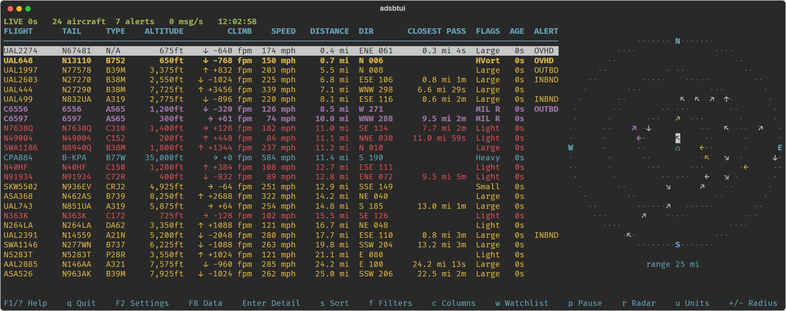
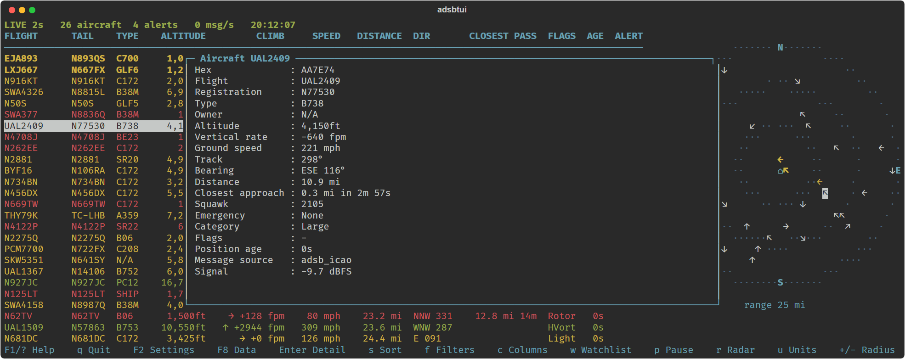

# ADSB-TUI

A terminal UI that lists aircraft near you from the `aircraft.json` feed of your own `readsb` or `dump1090-fa` receiver. It renders a sortable table and a radar scope with curses.

## Prerequisites

- Python 3.11+
- A `readsb` or `dump1090-fa` receiver whose `aircraft.json` you can reach by URL or file path (or use `--demo`, below)
- Windows only: `windows-curses`, installed by the `windows` extra



## Quickstart

1. Install:

```bash
git clone https://github.com/WPTK/ADSB-TUI.git
cd ADSB-TUI
pip install -e .            # Windows: pip install -e ".[windows]"
```

**Raspberry Pi OS** blocks plain `pip install`. Use pipx:

```bash
sudo apt install pipx && pipx ensurepath   # then open a new shell
pipx install --editable .
```

To update, `git pull` and restart adsbtui. A pipx install made without `--editable` won't pick
up the pull; fix it once with `pipx install --force --editable .`.

2. Start the app:

```bash
adsbtui
```

The first run starts a setup wizard that finds your receiver and home location and writes
`~/.config/adsbtui/config.toml`. To skip it:

```bash
adsbtui --url 192.0.2.10 --lat 37.7749 --lon -122.4194
```

`--url` takes a receiver address (the usual `aircraft.json` paths are probed), an exact URL, or
a local file such as `/run/readsb/aircraft.json`.

No receiver yet? `adsbtui --demo` shows scripted traffic around your home position (or San
Francisco if none is set). It needs no config and no network, never sends an alert, and writes
nothing to disk. The status line says DEMO.

## Keys

| Key | Action |
|---|---|
| `F1` / `?` | Help |
| `F2` / `,` | Settings (every option, saved to `config.toml`) |
| `F8` / `D` | Aircraft registry: status and manual update |
| `Enter` | Details for the selected aircraft |
| `Up` `Down` / `k` `j`, `PgUp` `PgDn`, `Home` `End` | Move the selection |
| `d` | Details (same as `Enter`) |
| `s` / `S` | Sort screen / reverse the sort |
| `f` or `/` / `c` / `w` | Filter and search / columns / watchlist |
| `r` / `u` / `p` | Toggle radar / cycle units / pause |
| `+` / `-` | Grow / shrink the radius |
| `q` / `F10` | Quit |

`F3`–`F7` open filters, sort, columns and watchlist as in the key bar. Help (`F1`) lists every key and scrolls.


The mouse works too: click a column header to sort by it (click again to reverse), click a row or a scope arrow to select it, and scroll the wheel to move the cursor. Hovering an arrow on the scope highlights its row and shows a tooltip; hover needs a terminal that reports mouse motion (most xterm-compatible ones) and is not available on every Windows console.



## Configuration

Press `F2` in the app to edit every option. The config file is `$ADSBTUI_CONFIG`, else
`$XDG_CONFIG_HOME/adsbtui/config.toml` (`~/.config/adsbtui/config.toml` by default); the current
directory is never searched. Flags override `ADSBTUI_<SECTION>_<KEY>` environment
variables, which override `config.toml`. The full key list, column meanings and the watchlist
format are in [docs/configuration.md](docs/configuration.md).

## License

[CC0 1.0](LICENSE): public domain, no warranty. Downloaded registry data has its own terms,
shown in the app: the FAA extract is public domain, tar1090-db is non-commercial use only.
